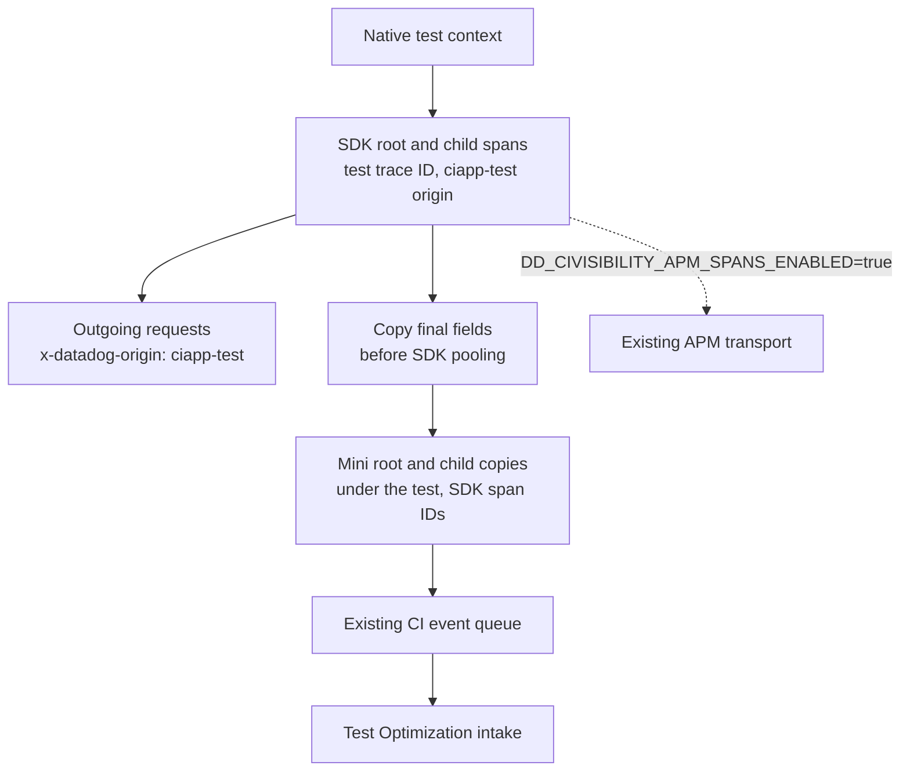

# SDK spans under Mini tests

When `ddtest instrument` builds a Mini test binary that uses `dd-trace-go/v2`,
SDK spans created under a test appear beneath that test in Test Optimization.
This works with manual SDK calls and [Orchestrion builds](orchestrion.md).

By default those spans are reported once, to Test Optimization:

- An SDK root span under a test, which the SDK starts without a parent (also
  under a baggage-only context), stays a root span, but it takes the test's
  128-bit trace ID, the `ciapp-test` origin and keep sampling priority. Its
  children inherit them, and the SDK's propagator sends them to the services
  the test calls, so those services' spans join the test's trace, with
  `x-datadog-origin: ciapp-test`, instead of an APM trace.
- Mini's copies keep the SDK span IDs, so the parent IDs that services receive
  name the copies.
- The SDK does not send those spans to APM, nor count them in its APM stats:
  their copies report them. With `DD_TRACE_DEBUG=true`, a debug line gives the
  number of spans of each finished chunk that were not sent, and why.

`DD_CIVISIBILITY_APM_SPANS_ENABLED=true` keeps the SDK spans unchanged and also
sends them to APM. Each copy then gets a new Mini span ID, and the SDK span
keeps its original trace ID, parent, sampling and APM delivery.

Pass the test context to application code:

```go
func TestRequest(t *testing.T) {
    // The application or test setup has already started the SDK tracer.
    root, ctx := tracer.StartSpanFromContext(t.Context(), "request")
    defer root.Finish()

    child, _ := tracer.StartSpanFromContext(ctx, "database")
    defer child.Finish()
}
```

In an instrumented binary, `t.Context()` retains Go's cancellation and values
and carries Mini's test identity. `testopt.Context(t)` works too. The context
returned by `tracer.StartSpanFromContext` carries both SDK and Mini identities
under separate keys; `propagation.FromContext` reads the Mini identity. By
default both name the same trace and span. With
`DD_CIVISIBILITY_APM_SPANS_ENABLED=true`, the SDK's propagator injects its
original APM identity and `propagation.FromContext` the independent Mini
identity.



## Which spans are copied

| SDK call or scenario | Test Optimization behavior |
| --- | --- |
| `StartSpanFromContext(t.Context(), ...)` | Copy beneath the current test |
| Child of a copied SDK span, including `StartChild` and `ChildOf` | Copy beneath that parent's copy |
| `ContextWithSpan(ctx, nil)` inside a test | Next SDK root gets a new copy beneath the test |
| `ChildOf` a baggage-only context inside a test | The SDK starts a root, which joins the test's trace like any other root |
| A different subtest context carrying an older SDK parent | The copy belongs to the current subtest; the SDK parent remains unchanged |
| `context.Background()` with no copied SDK parent | No copy; there is no test association |
| SDK spans created before the test or during package initialization | No copy without a test association |
| Concurrent subtests and in-process retries | Each copy belongs to its own test or attempt |
| Isolated process-retry child | No copies: these children have no local Mini test identity |
| Active fuzz mutation worker | No copies; mutations are outside Mini's test-event lifecycle |
| SDK not running or returning a no-op span | No copy |
| Native build or explicit `--runtime=sdk` | No Mini mirror hooks |

Process retries still report their test results through the controlling
process. Copying SDK spans from those isolated children would require a
cross-process event channel, which the mirror does not add. Examples have no
`testing.T` context. Fuzz seeds and callbacks can use their
native `testing.T` context; contextless operations retain the rule above.

Only an SDK root span under a test, and its descendants under the same test,
join the test's trace. A span whose SDK parent was created outside the test,
or under another test, keeps its SDK trace and is sent to APM; its copy gets a
new Mini span ID, as with `DD_CIVISIBILITY_APM_SPANS_ENABLED=true`. Spans that
are not copied are sent to APM as before.

SDK spans must finish while their owning Mini client is open; keeping a test
context after the test does not extend that client's lifetime. Copying local
spans does not reparent spans produced by remote services: they keep the
parent IDs that the SDK's propagator sent.

## Capture and delivery

The selective compiler hook adds private state to the SDK's `SpanContext`.
That context survives reuse of its `Span` object. At SDK finish, Mini copies
the final operation, service, resource, type, times, errors, tags and application
metrics. When the SDK span keeps its own trace, the copy also records
`apm.trace_id` and `apm.span_id` for diagnosis. Mini owns the CI hierarchy,
origin and runtime identity; SDK sampling and APM control metrics are omitted
from the copy.

Capture runs at the exit of SDK `finish`, while the span lock still protects
its data. It includes field updates after trace bookkeeping and later SDK
defers. A completion marker prevents early returns or a panic before bookkeeping
from emitting an unfinished span. Metadata and metrics are detached before
the SDK can clear a pooled span. Enqueuing runs after the SDK unlocks, so Mini
backpressure cannot hold that lock. Repeated or concurrent `Finish` calls
produce at most one copy.

The SDK span joins the test's trace in `spanStart`, after the SDK creates its
context and before it samples the trace, so the SDK keeps the priority that
the hook sets. When the SDK submits a finished chunk, the hook removes the
spans that joined a test's trace before the SDK computes stats or queues the
chunk. The chunk, even empty, still reaches the SDK's worker, which sends
nothing for the removed spans and releases them to the span pool. An oversized trace's spans that joined a
test's trace are likewise left out of the SDK's stats.

Copies use Mini's existing byte limits, gzip, HTTP retries and flush/close
handling. `DD_CIVISIBILITY_DEFERRED_DELIVERY=true` defers their delivery while
tests run. Delivery errors are logged and preserve the Go command's exit code.

The [goleak shim](delivery.md) pauses Mini delivery and filters Mini's own
workers. It does not suppress the independent SDK's workers or application
leaks. Tests that start an APM tracer retain their normal SDK shutdown and
goleak policy.

## Maintenance and checks

`internal/instrument/sdk_mirror.go` dispatches the edits;
`sdk_mirror_match.go` validates construction, context snapshots and finish/lock
anchors. The matcher follows each variable's role in the AST, so renaming a
receiver, parameter or local variable does not change the hook. Both short
declarations and `var` declarations can construct the returned SDK context.
Comments and strings containing `__ddto` are allowed; identifiers with that
prefix are reserved for generated code.

Each operation needs one anchor. Duplicate constructors, snapshot builders or
finish calls disable the optional mirror with a warning. The snapshot must come
from the supplied span under its nil guard and be used with that span and the
incoming context. Finish needs a direct lock and deferred unlock. Extra mutex references,
receiver aliases or reassignment are rejected because the hook cannot prove
that capture still owns the protected data. Moving these operations into new
helpers requires an explicit matcher update and behavioral tests.

`sdk_mirror_adopt.go` validates what joining a test's trace needs: `Span`'s
`spanID`, `traceID` and `context` fields; `traceID`'s value, hex cache,
`SetUpper`, `SetLower` and `cacheHex`; `SpanContext`'s `trace` and `origin`;
`setSamplingPriority` with a `samplernames.SamplerName`; the `ext` and
`samplernames` imports; `submitChunk` with a `*chunk` of `spans []*Span`; and
`computeOversizedSpanStats` resetting `statSpan` once. Before v2.11,
`ContextWithSpan` chains `context.WithValue` calls instead of building a
`spanCtx`, and `submit` computes each span's stats when it finishes; the
matcher accepts both layouts. Each group is one bit of the edits
`TransformSDKMirror` reports. Without all of them, the copies keep
their own identity, the SDK spans are sent to APM, and the CLI warns that SDK
spans under tests also go to APM, unless
`DD_CIVISIBILITY_APM_SPANS_ENABLED=true` asks for that.

The mirror supports every dd-trace-go release from v2.10.0 and the main
branch; [supported versions](maintenance.md#supported-dd-trace-go-and-orchestrion-versions)
explains how each one is tested. `TestMiniUnsupportedSDKMirrorRetainsTestReporting`
checks the fallback with a copy of v2.10.1 whose `ContextWithSpan` the matcher
does not recognize: incompatible mirror hooks produce a warning, the
application SDK compiles unchanged, and Mini still reports the tests. Mandatory CI ownership
guards remain active to prevent duplicate test reporting. Preparation validates
selected sources before compilation; late compiler inputs receive the same
optional-mirror fallback. Other layouts need their own mirror validation.

Bump the contracts in `sdkCompilerCacheMarker` whenever the compiler edits or
generated hook change. Go does not hash wrapper-generated source into its
original build action, so an unchanged marker can reuse an incompatible SDK
archive. CI guards and span copies have separate package-scoped compiler
markers; a disabled mirror omits the tracer marker, and native and SDK builds
use neither. `DD_CIVISIBILITY_APM_SPANS_ENABLED` is read when the test binary
starts, so it does not change the compiled SDK. When the SDK's own packages are
tested, Go also passes a marker to their test
variants. The internal test variant, which compiles the package's sources,
receives the same edits; the external test package and test main only lose
the marker, as with goleak.

The runtime uses cached typed `testing` offsets to bind the native context
before the test body runs, and it preserves `cancelCtx`. SDK-free Mini binaries
skip binding and allocate no mirror context. The mirror adds no span registry,
per-span reflection or worker goroutine.

`TestMiniSDKSpanMirror` checks final wire fields and propagation against real
APM and CI HTTP receivers in both modes: by default, that APM receives only the
spans outside tests, that copies keep the SDK span IDs and that an HTTP server
receives the test's trace ID, `x-datadog-origin: ciapp-test` and keep priority;
with `DD_CIVISIBILITY_APM_SPANS_ENABLED=true`, the original APM spans and
independent identity. `TestMiniSDKMirrorContextMatrix`
checks parallel isolation, cleanup cancellation, pooled contexts, in-process
retries, agent/agentless delivery, deferred delivery, goleak, Orchestrion and
`-race` with SDK coverage. The regular Go instrumentation workflow runs these
checks on Linux, macOS and Windows. `TestSDKMirrorCosmeticChanges` compiles and
executes transformed fixtures, including renames, context import aliases,
declaration styles, late field updates, early returns and panics. Rejection
tests cover duplicate anchors, foreign snapshots and unsupported locking.
`TestSDKMirrorAdoptionEdits`, `TestSDKMirrorAdoptionDrift`,
`TestSDKMirrorBeforeV211` and `TestSDKMirrorHookCompiles` cover the edits that
join a test's trace, their fallback when the SDK changes, the layout before
v2.11, and the generated hook with and without them.
Runtime unit tests cover detached map ownership, concurrent capture, which
spans join a test's trace and the SDK-free allocation path.
